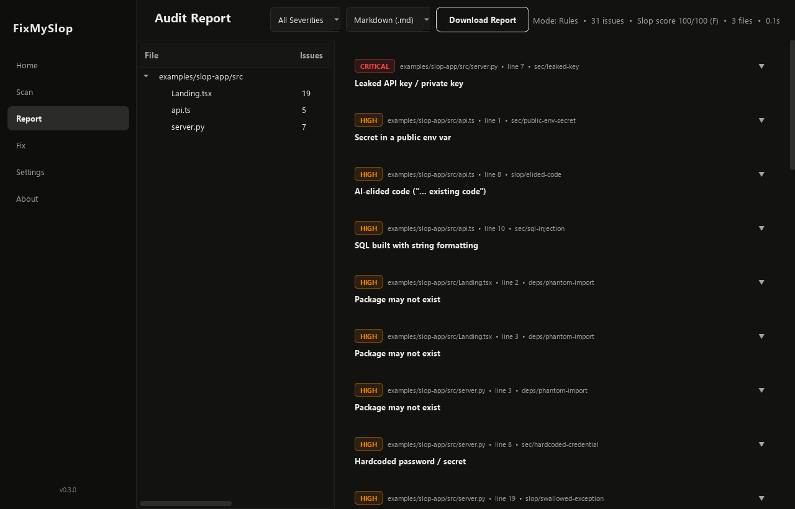

# FixMySlop

[](https://github.com/MrSpideyNihal/FixMySlop/actions/workflows/python-package.yml)
[](LICENSE)
[](https://python.org)

**The slop linter for the AI-agent era.** FixMySlop catches the things AI coding agents get wrong — the
purple-gradient landing page, the `// ... existing code ...` that silently deleted half a file, the npm
package that doesn't exist, the OpenAI key in `NEXT_PUBLIC_` — in milliseconds, without an LLM. Then it
hands a precise fix list to the agent you already use (Claude Code, Codex, Cursor, Gemini) and re-scans to
prove it's fixed.

```text
$ fixmyslop scan

src/components/Hero.tsx
     12  MED   ui/ai-gradient             Purple-to-pink "AI gradient"
     14  MED   ui/gradient-text           Gradient-filled text
     15  MED   ui/marketing-slop          Generic AI marketing copy
     18  MED   ui/fake-social-proof       Invented stats or testimonials
     22  MED   a11y/icon-button           Icon-only button without a label
src/lib/api.ts
      8  HIGH  slop/elided-code           AI-elided code ("... existing code")
      1  HIGH  sec/public-env-secret      Secret in a public env var
src/server.py
      3  HIGH  deps/phantom-import        Package may not exist

┌─ FixMySlop ───────────────────────────────────────────────────────┐
│ Slop score 100/100  grade F   31 issues · 3 files · 0.09s         │
└───────────────────────────────────────────────────────────────────┘
```

## Why this exists when you already have a frontier model

Frontier models are great at fixing slop and bad at noticing their own. They write the purple gradient
because it's the statistical default; they elide code when an edit gets long; they import packages that
sound right. FixMySlop is the other half of the loop:

| | Your agent | FixMySlop |
|---|---|---|
| Speed | seconds–minutes per review | ~0.5s for a 10k-line repo |
| Determinism | different answer each run | same input → same findings, stable rule IDs |
| Cost | tokens on every review | free, offline, no API key |
| Good at | *fixing* code | *finding* the tells, every time, in CI |

So: FixMySlop **finds**, your agent **fixes**, FixMySlop **verifies**. The old "local LLM reviews your code"
mode still exists (`--llm`), but it's optional — the rules engine is the product.

## Install

```bash
pipx install fixmyslop            # or: pip install fixmyslop
# latest from GitHub:
pipx install git+https://github.com/MrSpideyNihal/FixMySlop
```

JavaScript project? `npx fixmyslop scan` works too (it runs the same CLI through `uvx`/`pipx`).

Optional: `pip install "fixmyslop[analysis]"` adds Ruff + Bandit findings for Python, `"fixmyslop[gui]"` adds the desktop app.

## 30 seconds

```bash
fixmyslop scan                    # whole repo
fixmyslop scan --changed          # only what changed vs main (+ uncommitted)
fixmyslop scan --open             # interactive HTML report with copy-to-agent fix prompts
fixmyslop fix --safe-only         # behavior-preserving auto-fixes
fixmyslop fix                     # safe fixes → hand the rest to your agent → re-scan
fixmyslop init --claude           # make Claude Code check its own work, live
```

Try it on the bundled demo: `fixmyslop scan examples/slop-app`.

## What it catches

**UI slop** — the visual and copy tells of generated frontends (React, Vue, Svelte, Astro, HTML, CSS, Tailwind)

| Rule | Catches |
|---|---|
| `ui/ai-gradient` | `from-purple-600 to-pink-500`, `#667eea → #764ba2` |
| `ui/gradient-text` | `bg-clip-text text-transparent` headlines |
| `ui/emoji-icons` | 🚀 ⚡ ✨ used as feature icons |
| `ui/marketing-slop` | "Revolutionize", "Unlock the power of", "seamless", "next-gen" |
| `ui/fake-social-proof` | "10,000+ happy users", "99.9% uptime", testimonials from "Sarah Johnson" |
| `ui/placeholder-copy` | Lorem ipsum, "Your Company Name" |
| `ui/glassmorphism`, `ui/blur-blobs`, `ui/hover-scale`, `ui/heavy-shadows`, `ui/gimmick-animation` | the template aesthetic |
| `ui/rainbow-palette`, `ui/palette-sprawl`, `ui/arbitrary-color`, `ui/arbitrary-values` | no design system: 9 accent hues, 40 hex codes, `w-[347px]` |
| `ui/default-font`, `ui/z-index-war`, `ui/important-abuse` | Inter-everywhere, `z-index: 9999`, `!important` piles |

**Accessibility** — `a11y/img-alt`, `a11y/clickable-div`, `a11y/icon-button`, `a11y/focus-removed`, `a11y/dead-link`

**Code slop** — `slop/elided-code` (`// ... existing code ...`), `slop/placeholder-impl` ("in a real app you would…"),
`slop/stub-function`, `slop/swallowed-exception`, `slop/empty-catch`, `slop/bare-except`, `slop/narrating-comment`,
`slop/step-comments`, `slop/debugger`, `slop/console-log`, `slop/emoji-log`, `slop/ts-any`, `slop/ts-ignore`,
`slop/blanket-suppression`, `slop/placeholder-credential`, `slop/ai-voice`

**Dependencies** — `deps/phantom-import`: imports that aren't stdlib, local, declared, or installed (hallucinated
packages are what [slopsquatting](https://en.wikipedia.org/wiki/Slopsquatting) attacks register).
`--online` confirms against PyPI / npm. `deps/undeclared-import`: works on your machine, breaks in CI.

**Security** — `sec/leaked-key` (OpenAI/Anthropic/AWS/GitHub/Stripe/Google key formats, private keys — always
redacted in output), `sec/public-env-secret` (`NEXT_PUBLIC_*SECRET*`, `VITE_*OPENAI*`), `sec/hardcoded-credential`,
`sec/sql-injection`, `sec/cors-wildcard`, `sec/tls-disabled`, `sec/raw-html`, `sec/eval`

Plus Ruff, Bandit and Semgrep findings when installed. `fixmyslop rules` lists everything;
`fixmyslop rules ui/ai-gradient` explains one.

## Use it with your agent

### Claude Code

```bash
fixmyslop init --claude
```

This installs four things, all idempotent:

- a **skill** (`.claude/skills/fixmyslop/SKILL.md`) so Claude reaches for FixMySlop on its own when it builds UI or finishes a task
- an **MCP server** in `.mcp.json` with `check_slop`, `fix_safe`, `explain_rule`, `slop_guide` tools
- a **PostToolUse hook** — every file Claude writes is checked instantly; only the lines it just wrote are reported, and Claude is told to fix them before moving on
- anti-slop rules in **CLAUDE.md**

`fixmyslop init --user` installs the skill for every project on your machine.

### Cursor, Codex, Gemini, Windsurf, anything with MCP

```bash
fixmyslop init --cursor          # .cursor/rules + .cursor/mcp.json
fixmyslop init --agents          # AGENTS.md (Codex, Gemini, Jules, Copilot agents)
claude mcp add fixmyslop -- fixmyslop mcp     # or register the MCP server anywhere
```

### Hand off a fix

```bash
fixmyslop fix                          # auto-detects claude / codex / gemini on PATH
fixmyslop fix --agent claude --yes
fixmyslop fix --agent-cmd "aider --message-file {brief} --yes"
fixmyslop fix --agent llm -b https://openrouter.ai/api/v1 -m <model>   # any OpenAI-compatible API, incl. Ollama
fixmyslop scan -f prompt > brief.md    # or paste the brief yourself
```

`fix` applies safe deterministic fixes first, writes a brief to `.fixmyslop/brief.md` (file-by-file checklist with
a concrete fix for every rule plus UI design direction), runs the agent, re-scans, and repeats for up to `--rounds`.
It ends with the before/after score.

## CI

```yaml
# .github/workflows/fixmyslop.yml   (or: fixmyslop init --github)
on: [pull_request]
permissions: { contents: read, security-events: write }
jobs:
  slop:
    runs-on: ubuntu-latest
    steps:
      - uses: actions/checkout@v4
        with: { fetch-depth: 0 }
      - uses: MrSpideyNihal/FixMySlop@main
        with: { fail-on: high, changed-only: true }
```

Findings show up as inline PR annotations (SARIF). pre-commit:

```yaml
repos:
  - repo: https://github.com/MrSpideyNihal/FixMySlop
    rev: v0.3.0
    hooks: [{ id: fixmyslop }]
```

## Configure

`.fixmyslop.yml` (or `[tool.fixmyslop]` in pyproject.toml), created by `fixmyslop init`:

```yaml
exclude: ["legacy/**", "**/*.generated.ts"]
disable: ["ui/default-font"]           # ids or groups: ui, a11y, slop, sec, deps
severity: {"slop/console-log": "INFO"}
fail_on: high
hook: { min_severity: MEDIUM }
```

Silence one finding with a reason: `// fixmyslop-ignore[ui/gradient-text] brand guideline`.
Skip a file: `fixmyslop-ignore-file` in its first lines. Paths passed explicitly are always scanned.

## Output formats

`-f text` (default) · `compact` (one line per issue, for agents) · `prompt` (fix brief) · `sarif` · `json` ·
`markdown` · `html` (interactive: filters, search, "copy fix prompt" per file) · `csv` · `pdf`. Save with `-s report.html` (format inferred from the extension).
Exit codes: `0` clean, `1` issues at/above `--fail-on`, `2` usage error.

## Slop score

0 (clean) to 100, from severity-weighted findings per 1,000 lines, so a 500-line app and a 500k-line monorepo
are comparable. Grades: A < 10 ≤ B < 25 ≤ C < 45 ≤ D < 65 ≤ F. FixMySlop's own repo is scanned in CI and holds an A.

## Optional: LLM review and the desktop app

`fixmyslop scan --llm` adds a model review pass over each file (Ollama, llama.cpp, vLLM, LM Studio, or any
OpenAI-compatible endpoint via `--base-url`/`--api-key`/`--model`, or `FIXMYSLOP_*` env vars). It's slow and
non-deterministic, so it's off by default.

`fixmyslop gui` (needs `fixmyslop[gui]`) opens the desktop app: scan, browse findings by file, export reports.
For most people `fixmyslop scan --open` is the faster way to browse results.



## Development

```bash
pip install -e ".[analysis,dev]"
pytest -q
fixmyslop scan . --fail-on medium     # the repo must stay clean
```

Adding a rule: write a check in `fixmyslop/core/slop/rules_*.py` with the `@rule` decorator (or `line_rule` for a regex),
then add a sloppy + clean pair to `tests/test_slop_rules.py`. Every rule needs a `why` and an actionable `fix` —
the fix text is what agents follow.

## License

MIT
